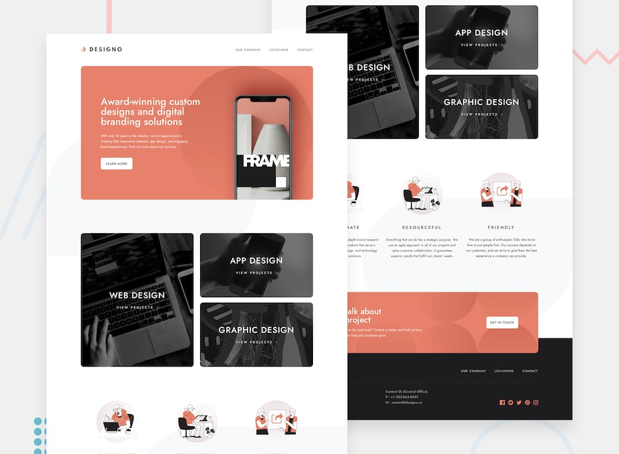

# Designo agency website

## Table of contents

- [Overview](#overview)
  - [The job](#the-job)
  - [Links](#links)
- [Built with](#built-with)
- [Author](#author)

## Overview

### The job

Users should be able to:

- Implement a WordPress site.
- Mockups `/docs/mockups`
- Manage all page content using WordPress blocks and the dedicated Designo theme
- View editable office details on the Locations page
- View automatically displayed, editor-managed Google Maps on the Locations page

### Links

- Repository: [https://github.com/ferfalcon/designo-multi-page-website](https://github.com/ferfalcon/designo-multi-page-website)
- Live Site: [https://designo-multi-page-website.ferfalcon.shop/](https://designo-multi-page-website.ferfalcon.shop/)

## Designo block theme

Theme: [`web/wp-content/themes/designo/`](web/wp-content/themes/designo/).
See the [theme setup and editor guide](web/wp-content/themes/designo/README.md) for starter-content import, editing, permissions, contact forms, testing, and the Google Maps feature.

## Local development

See [Development and deployment](docs/development-tools.md) for fresh DDEV setup, verification, the GitHub branch/PR workflow, and manual deployment safety notes.

Only the custom theme is versioned under `web/`; WordPress core, plugins, uploads, database exports, credentials, and local DDEV configuration are excluded. Install WordPress and dependencies locally using the guide. There is no automatic production deployment.

## Built with

- WordPress
- Penpot
- pi
- ddev

## Author

- Website - [Fer Falcon](https://www.ferfalcon.com)
- Linkedin - [Fernando Falcon](https://www.linkedin.com/in/fernandofalcon/)
